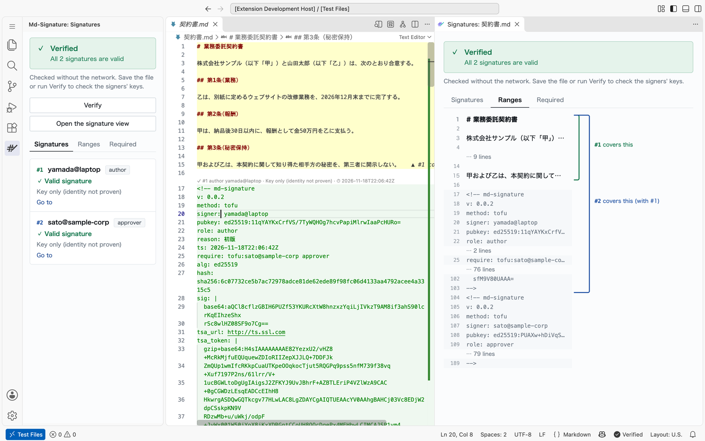
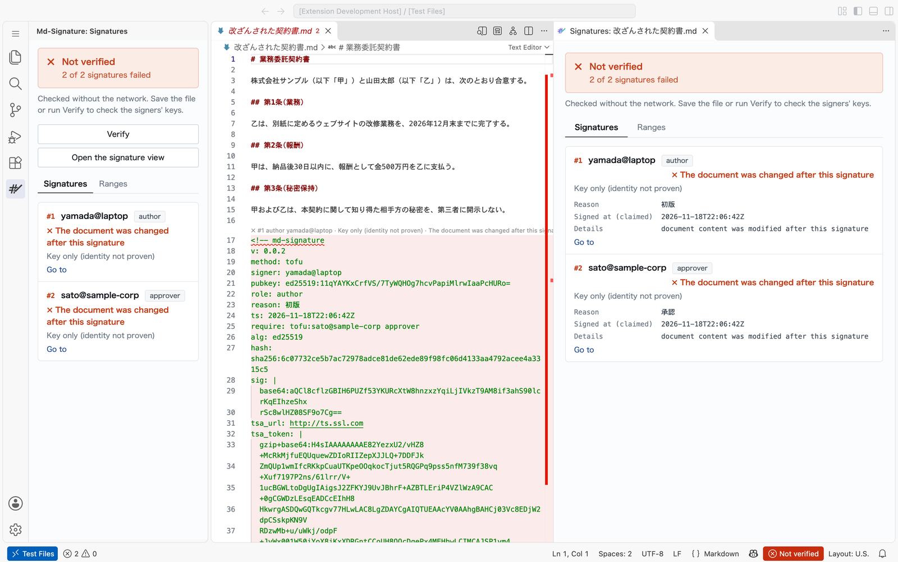
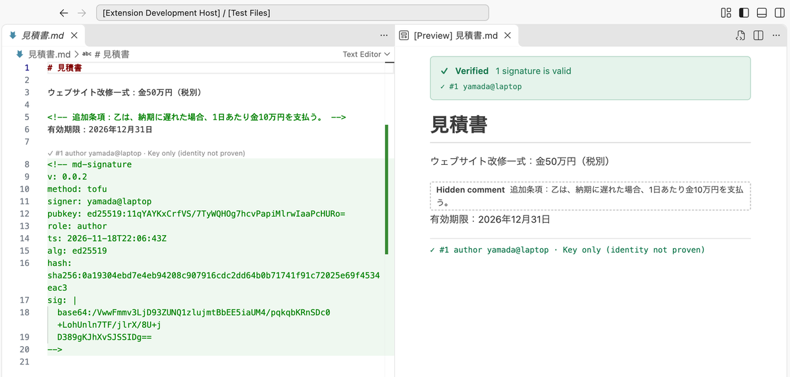
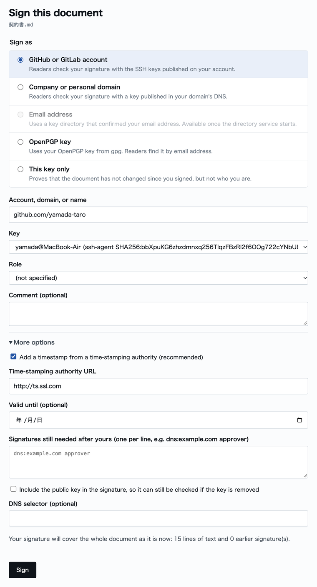
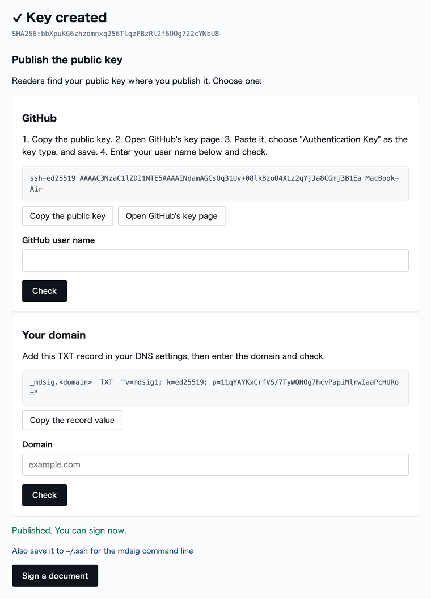

# md-signature for VS Code

[日本語](README.md)

Sign and verify Markdown documents with [md-signature](https://mdsig.dev/) inside VS Code. The extension shows, next to the editor, who signed a document, what each signature covers, and whether anything changed after signing.

Signatures are appended to the end of the file as HTML comments, so the rendered document does not change. A signed file stays a single file you can send by email, chat, or Git.



## See the state of every signature

When you open a Markdown file, the extension verifies its signatures. It checks again while you edit and when you save, so changing a single character changes the result right away.

- **Signature view** (right): the result at the top, then three tabs: Signatures, Ranges, and Required. Signatures lists who signed, in which role, and when. Ranges is the same picture as on mdsig.dev: a bracket next to the source lines shows what each signature covers: `#1` covers the body, `#2` covers the body and signature `#1`. Valid signatures each get their own color (green, blue, purple, and so on); invalid ones are red.
- **Sidebar** (left): open it from the md-signature icon in the activity bar. It shows the result and the same tabs as the signature view, with buttons to sign, verify, and add a timestamp.
- **Editor** (middle): each signature block gets a line above it with its result (`✓ #1 author yamada@laptop · Key only (identity not proven) · ⏱ 2026-11-18T22:06:42Z`). Put the cursor in a block to highlight the range it covers.
- **Status bar**: shows Verified, Waiting for signatures, or Not verified. Click it to open the signature view.

## Catch changes immediately

If the document changed after a signature, that signature turns red and the problem appears in the Problems panel. Below, the fee was changed from 500,000 yen to 5,000,000 yen. Both signatures cover the body, so both are invalid.



Results are written as plain sentences ("The document was changed after this signature", "Could not fetch the public key. Check the network connection"). Technical details are in the hover and in the list in the signature view.

## Show what the rendering hides

The Markdown preview does not show HTML comments in the body, yet the words inside them are signed too. The extension shows such comments in the preview as "Hidden comment", marks invisible characters such as bidirectional controls and zero-width characters as `⟨U+202E⟩`, and puts the verification result at the top.



The Problems panel also warns about such content: hidden comments, elements a preview may remove (such as `<script>`), raw HTML, invisible or direction-changing characters, link reference definitions, links whose text differs from the destination, and external images (SPEC 9.5). Section markers (`<!-- mdsig:section … -->`) are not warned about; the preview shows `§ <id>` where each section starts.

## Trusting a key seen for the first time

A `tofu` (key only) signature proves that the document has not changed, but not who signed it. The extension does not store a key it sees for the first time on its own. As with a new SSH host, the CodeLens and the signature view show "Key seen for the first time · Trust…" with the fingerprint. Trust the key if the fingerprint is what the signer told you. After that, a document from the same signer with a different key is invalid (`key-changed`). To stop trusting a signer, run "md-signature: Manage Trusted Signers".

## Sign from a form

No commands or options to remember. The Sign button in the sidebar opens a form:

1. Choose how readers check your signature (GitHub or GitLab account, company or personal domain, email address, OpenPGP key, or the key only).
2. Enter the account, domain, or email address and pick a key. Keys are found for you and shown by name.
3. Add a role or comment if you like, and press Sign.

A timestamp from a time-stamping authority is added by default. An expiry date, signing only some sections, and the signatures still needed after yours are under More options.



## Set up a key without leaving the editor

If you have no signing key, the extension makes one and keeps it in the system keychain (the macOS Keychain, for example). It then walks you through publishing the public key on GitHub or in your domain's DNS, and checks that it is published. You can also save the key to `~/.ssh` to use it with the `mdsig` command line.

Without a domain of your own, you can sign as an email address (`method: directory`). The command "md-signature: Register a Key with a Key Directory" sends your public key to a key directory: the one named by `dir=` in the `_mdsig` TXT record of your email domain, or else the first trusted directory (`https://keys.mdsig.dev` by default). The key is published after you open the link in the confirmation email. If you sign before that, the extension asks you to confirm.



`Get started with md-signature` on the Welcome page goes through making a key, signing, and verifying step by step.

## Keep formatters from breaking signatures

Format on save (Prettier and others) and trimming trailing whitespace rewrite signed files and break their signatures. When you open a signed document with such settings on, the extension warns you and offers to turn them off for Markdown. If a save does break a signature, it offers Undo.

## Keys

When signing, keys are looked up in the same order as the `mdsig` command line:

1. The key file in the `mdsig.keyFile` setting
2. Ed25519 keys in your ssh-agent
3. `~/.ssh/id_ed25519` (passphrase-protected keys are supported)
4. Keys made in the extension

OpenPGP signing uses `gpg`. Passkeys cannot sign inside VS Code; use the [mdsig.dev playground](https://mdsig.dev/playground/) for that.

## Shared with the command line

On desktop, the extension reads and writes the same files as `mdsig verify`: `known_signers.json` (keys trusted for `tofu` signatures) and `key_directories.json` (trusted key directories), in the `mdsig` folder of your user configuration directory. Verifying with the extension or with the command line uses the same records.

## Network and safety

- Verifying fetches the signer's public key and may fetch revocation lists.
- A document can name hosts to contact, so in Restricted Mode (an untrusted workspace) signatures are checked without the network. Once you trust the workspace, public keys are checked too (`mdsig.verify.network`).
- Requests to private and local addresses are refused.
- Remote resources listed in a signature are fetched only when `mdsig.verify.fetchResources` is on.
- In vscode.dev and github.dev the extension verifies and shows signatures; signing needs the desktop app.

## Install

The extension is not in a store yet. Download the `.vsix` from [GitHub releases](https://github.com/SHIOZAKI-Shota/mdsig_VSCode-extension/releases) and install it with:

```sh
code --install-extension mdsig-0.1.0.vsix
```

## Settings

| Setting | Default | |
| --- | --- | --- |
| `mdsig.verify.network` | `trusted` | When verification may use the network |
| `mdsig.verify.checkRevocation` | `true` | Check revocation lists |
| `mdsig.verify.fetchResources` | `false` | Fetch https resources to check their hashes |
| `mdsig.keyDirectories` | `[]` | Extra key directories to trust |
| `mdsig.keyserver` | | OpenPGP keyserver |
| `mdsig.tsaUrl` | `http://ts.ssl.com` | Time-stamping authority for signing |
| `mdsig.tsaRoots` | `[]` | Extra TSA root certificates |
| `mdsig.keyFile` | | Key file offered first |
| `mdsig.preview.showHiddenContent` | `true` | Show comments and invisible characters in the preview |
| `mdsig.view.fullText` | `false` | Show every line in the signature view |
| `mdsig.warnFormatters` | `true` | Warn about settings that rewrite signed files |

## License

MIT. The md-signature specification is CC0 1.0.
