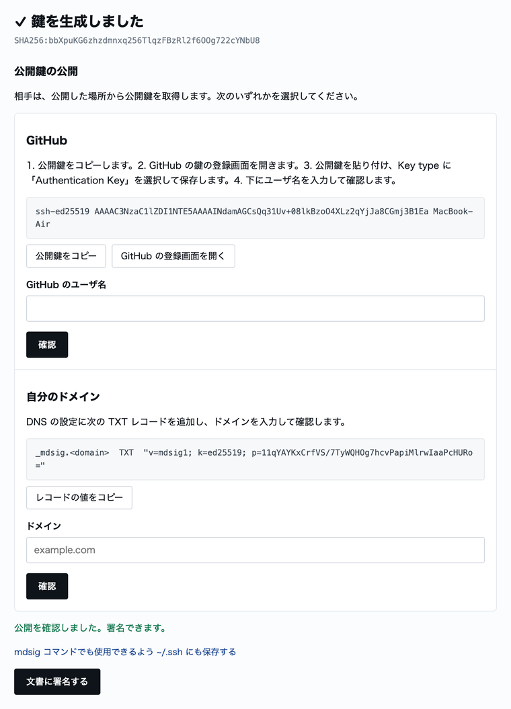

# md-signature for VS Code

[English](README.en.md)

[md-signature](https://mdsig.dev/) による Markdown 文書の署名と検証を、VS Code の中で行う拡張機能です。誰が署名したか、各署名が文書のどこまでを対象とするか、署名後に文書が変更されていないかを、エディタの横に表示します。

署名はファイル末尾の HTML コメントとして追記されるため、文書の表示に影響しません。署名済みのファイルは1つのファイルのまま、メールやチャット、Git でそのまま受け渡せます。


## 署名の状態を一目で確認

Markdown ファイルを開くと、拡張機能が署名を自動で検証します。編集中も保存時も検証し直すため、文書を1文字でも変更すると、その場で結果が変わります。

- **署名ビュー**（画面右）：上部に検証結果を表示し、その下を「署名」「範囲」「必要な署名」のタブに分けています。「署名」は署名者・役割・時刻などの一覧です。「範囲」は mdsig.dev の図と同じ表現で、ソースの行の横に、署名ごとの括弧を表示します。`#1` の括弧は本文を、`#2` の括弧は本文と `#1` の署名を対象とすることを示します。有効な署名は署名ごとに色を変え（緑、青、紫など）、無効な署名は赤で表示します。
- **サイドバー**（画面左）：アクティビティバーの md-signature のアイコンから開きます。検証結果と、署名ビューと同じタブを表示し、署名・検証・タイムスタンプ追加をボタンで実行できます。
- **エディタ**（画面中央）：各署名ブロックの上に結果を1行で表示します（`✓ #1 author yamada@laptop · 鍵のみ（身元は未証明） · ⏱ 2026-11-18T22:06:42Z`）。カーソルを署名ブロックに置くと、その署名の対象範囲を強調表示します。
- **ステータスバー**：右下に「検証済み」「署名待ち」「未検証」を表示します。クリックすると署名ビューを開きます。

## 改変をすぐに検出

署名の後に文書が変更されている場合は、該当する署名を赤で表示し、「問題」パネルにも表示します。次の画面は、報酬の「金50万円」を「金500万円」に書き換えた文書です。本文はどちらの署名の対象にも含まれるため、2件とも無効と判定されます。


結果は、専門用語ではなく文で示します（「この署名の後に文書が変更されています」「公開鍵を取得できませんでした。ネットワークの接続を確認してください」など）。技術的な詳細は、ホバーと署名ビューの一覧で確認できます。

## 表示されない内容を可視化

Markdown のプレビューでは、本文中の HTML コメントは表示されません。しかし、コメントの中の文言も署名の対象に含まれます。この拡張機能は、プレビューにコメントの内容を「非表示のコメント」として表示し、双方向制御文字やゼロ幅文字などの不可視の文字も `⟨U+202E⟩` の形で示します。プレビューの先頭には検証結果を表示します。


## フォームから署名

コマンドやオプションを覚える必要はありません。サイドバーの「署名」ボタンを押すと、署名フォームを開きます。

1. 相手が署名を検証する方法を選択します（GitHub・GitLab のアカウント、会社または個人のドメイン、OpenPGP 鍵、鍵のみ）。
2. アカウントやドメインを入力し、鍵を選択します。鍵は自動で探し、人が読める名前で表示します。
3. 必要に応じて役割やコメントを入力し、「署名」を押します。

時刻認証局のタイムスタンプは既定で付与します。有効期限、一部のセクションのみへの署名、後に続く必要な署名の指定は「詳細設定」にまとめています。


## 鍵の準備も画面で完結

署名用の鍵がない場合は、拡張機能が鍵を生成し、システムのキーチェーン（macOS のキーチェーンなど）に保存します。続けて、公開鍵を GitHub または自分のドメインの DNS に公開する手順を案内し、公開できたかを拡張機能が確認します。`mdsig` コマンドでも使用できるよう、鍵を `~/.ssh` に保存することもできます。



ようこそページの「md-signature を始める」から、鍵の作成、署名、検証までを順に確認できます。

## フォーマッタによる署名の破損を防止

保存時の整形（Prettier など）や行末の空白の削除は、署名済みのファイルを書き換え、署名を無効にします。署名済みの文書を開いたときにこれらの設定が有効であれば、拡張機能が警告し、Markdown について無効にすることを提案します。保存によって署名が無効になった場合は、「元に戻す」を提示します。

## 使用できる鍵

署名時は、`mdsig` コマンドと同じ順序で鍵を探します。

1. 設定 `mdsig.keyFile` で指定した鍵ファイル
2. ssh-agent に登録した Ed25519 鍵
3. `~/.ssh/id_ed25519`（パスフレーズ付きの鍵にも対応）
4. 拡張機能で作成した鍵

OpenPGP の署名には `gpg` を使用します。パスキーでは VS Code の中から署名できないため、[mdsig.dev のデモ](https://mdsig.dev/playground/)を使用してください。

## コマンドとの共有

デスクトップ版では、`mdsig verify` と同じファイルを読み書きします。ユーザ設定ディレクトリの `mdsig` フォルダにある `known_signers.json`（`tofu` 署名で初めて確認した鍵）と `key_directories.json`（信頼する鍵ディレクトリ）です。拡張機能とコマンドのどちらで検証しても、同じ記録を使用します。

## ネットワークと安全性

- 署名の検証では、署名者の公開鍵を取得し、撤回リストを取得する場合があります。
- 文書は接続先のホストを指定できるため、制限モード（信頼していないワークスペース）では、ネットワークを使用せずに検査します。ワークスペースを信頼すると、公開鍵も確認します（設定 `mdsig.verify.network`）。
- プライベートアドレスとローカルアドレスへの接続は拒否します。
- 署名が列挙するリモートのリソースは、`mdsig.verify.fetchResources` が有効な場合に限り取得します。
- vscode.dev と github.dev では、検証と表示に対応します。署名にはデスクトップ版が必要です。

## インストール

現在はストアに公開していません。[GitHub のリリース](https://github.com/SHIOZAKI-Shota/mdsig_VSCode-extension/releases)から `.vsix` をダウンロードし、次のコマンドでインストールします。

```sh
code --install-extension mdsig-0.1.0.vsix
```

## 設定

| 設定 | 既定値 | 内容 |
| --- | --- | --- |
| `mdsig.verify.network` | `trusted` | 検証時にネットワークを使用する条件 |
| `mdsig.verify.checkRevocation` | `true` | 撤回リストを確認する |
| `mdsig.verify.fetchResources` | `false` | https のリソースを取得してハッシュを確認する |
| `mdsig.keyDirectories` | `[]` | 追加で信頼する鍵ディレクトリ |
| `mdsig.keyserver` | | OpenPGP の鍵サーバ |
| `mdsig.tsaUrl` | `http://ts.ssl.com` | 署名時に使用する時刻認証局 |
| `mdsig.tsaRoots` | `[]` | 追加で信頼する TSA のルート証明書 |
| `mdsig.keyFile` | | 最初に提示する鍵ファイル |
| `mdsig.preview.showHiddenContent` | `true` | プレビューでコメントと不可視の文字を表示する |
| `mdsig.view.fullText` | `false` | 署名ビューで全行を表示する |
| `mdsig.warnFormatters` | `true` | 署名済みのファイルを書き換える設定を警告する |

## ライセンス

MIT。md-signature の仕様は CC0 1.0 です。
