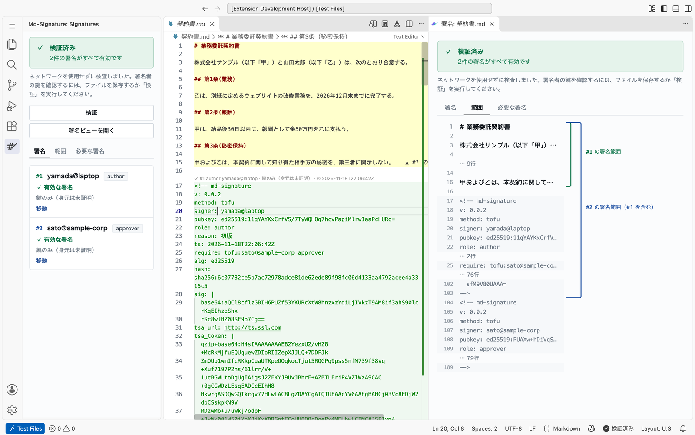
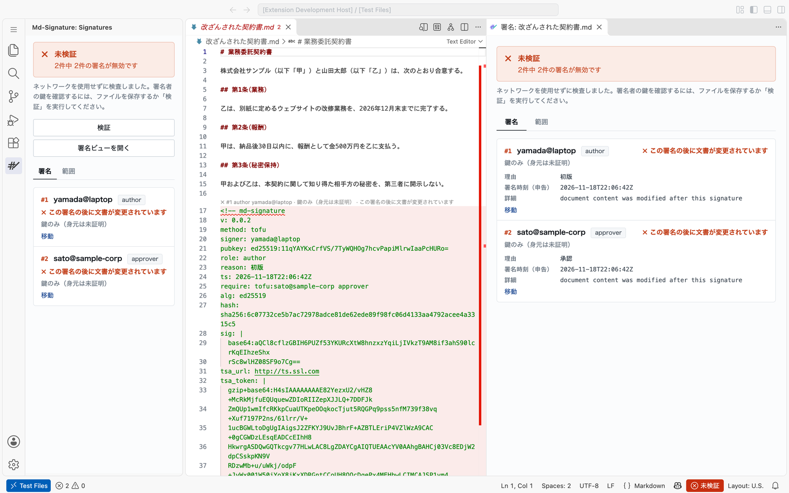
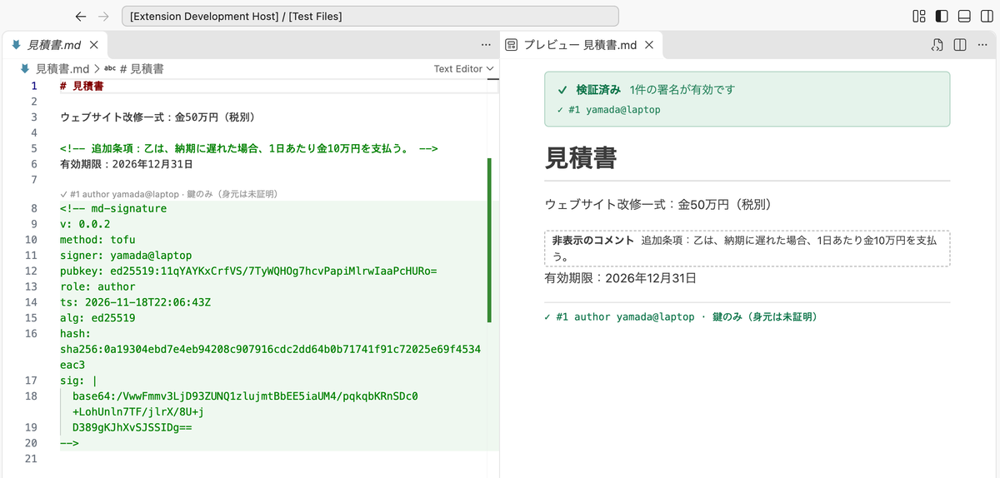
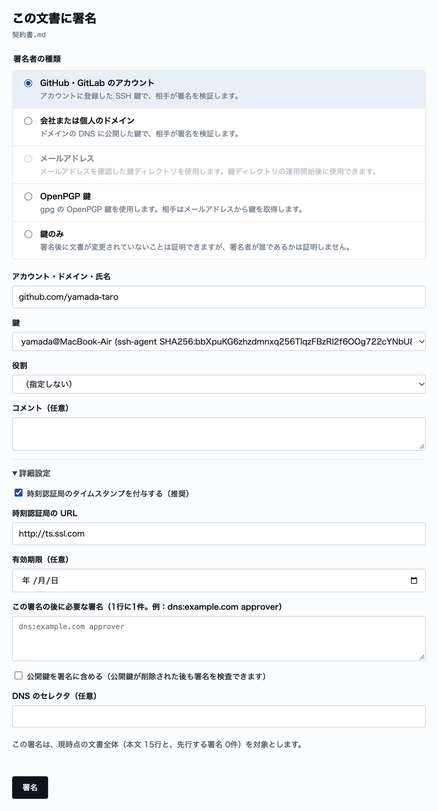

# md-signature for VS Code

[English](README.en.md)

[md-signature](https://mdsig.dev/) による Markdown 文書の署名と検証を、VS Code の中で行う拡張機能です。誰が署名したか、各署名が文書のどこまでを対象とするか、署名後に文書が変更されていないかを、エディタの横に表示します。

署名はファイル末尾の HTML コメントとして追記されるため、文書の表示に影響しません。署名済みのファイルは1つのファイルのまま、メールやチャット、Git でそのまま受け渡せます。



## 署名の状態を一目で確認

Markdown ファイルを開くと、拡張機能が署名を自動で検証します。編集中も保存時も検証し直すため、文書を1文字でも変更すると、その場で結果が変わります。

- **署名ビュー**（画面右）：上部に検証結果と文書全体の警告を表示し、その下を「署名」「範囲」「必要な署名」「署名表」のタブに分けています。「署名」は署名者・役割・時刻などの一覧です。署名者が表示名（`display_name`）を付けている場合は、検証済みの署名者の横に「（自己申告）」と併記します。「範囲」は mdsig.dev の図と同じ表現で、ソースの行の横に、署名ごとの括弧を表示します。`#1` の括弧は本文を、`#2` の括弧は本文と `#1` の署名を対象とすることを示します。有効な署名は署名ごとに色を変え（緑、青、紫など）、無効な署名は赤で表示します。「必要な署名」は、`require` を指定した署名ごとに、段階・必要な人数・署名済みの署名者と、数えられなかった署名の理由（順番より前、名簿に未登録、利用者確認なしなど）を表示します。「署名表」は、本文に `<!-- mdsig:signatures -->` がある文書で、検証結果から生成した署名表を表示します。
- **サイドバー**（画面左）：アクティビティバーの md-signature のアイコンから開きます。検証結果と、署名ビューと同じタブを表示し、署名・検証・タイムスタンプ追加をボタンで実行できます。
- **エディタ**（画面中央）：各署名ブロックの上に結果を1行で表示します（`✓ #1 author yamada@laptop · 鍵のみ（身元は未証明） · ⏱ 2026-11-18T22:06:42Z`）。時刻は、その署名より後にあるタイムスタンプのブロックから得た時刻です。カーソルを署名ブロックに置くと、その署名の対象範囲を強調表示します。
- **ステータスバー**：右下に「検証済み」「署名待ち」「一部を検査できません」「未検証」を表示します。必要な署名の確認に名簿やネットワークが使えなかった場合は「一部を検査できません」、対応していない規則が指定されている場合は「未検証」になります。クリックすると署名ビューを開きます。

## 改変をすぐに検出

署名の後に文書が変更されている場合は、該当する署名を赤で表示し、「問題」パネルにも表示します。次の画面は、報酬の「金50万円」を「金500万円」に書き換えた文書です。本文はどちらの署名の対象にも含まれるため、2件とも無効と判定されます。



結果は、専門用語ではなく文で示します（「この署名の後に文書が変更されています」「公開鍵を取得できませんでした。ネットワークの接続を確認してください」など）。技術的な詳細は、ホバーと署名ビューの一覧で確認できます。

## 表示されない内容を可視化

Markdown のプレビューでは、本文中の HTML コメントは表示されません。しかし、コメントの中の文言も署名の対象に含まれます。この拡張機能は、プレビューにコメントの内容を「非表示のコメント」として表示し、双方向制御文字やゼロ幅文字などの不可視の文字も `⟨U+202E⟩` の形で示します。プレビューの先頭には検証結果を表示します。



こうした内容は問題パネルにも警告として表示します。対象は、表示されないコメント、プレビューで除去される可能性のある要素（`<script>` など）、生の HTML、不可視文字・双方向制御文字、表示されないリンク参照定義、表示と移動先が異なるリンク、外部画像です（SPEC 9.5）。セクション署名の印（`<!-- mdsig:section … -->`）と署名表の印（`<!-- mdsig:signatures -->`）は警告しません。プレビューでは、セクションの開始位置に `§ <ID>` を表示します。署名表はプレビューには描画せず、印の位置に「署名表（署名ビューを参照）」とだけ表示します。VS Code のプレビューでは本文の HTML と表を分離できず、本文に書かれた偽の署名表と区別できないためです（SPEC 9.5）。

## 初めて検出した鍵の信頼

`tofu`（鍵のみ）の署名は、文書が改変されていないことは証明しますが、署名者が誰かは証明しません。この拡張機能は、初めて検出した鍵を自動では記録しません。SSH で初めて接続するサーバと同じく、CodeLens と署名ビューに「初めて検出した鍵 · 信頼する…」とフィンガープリントを表示します。フィンガープリントが署名者から伝えられたものと一致する場合に信頼してください。以後、同じ署名者が別の鍵で署名した文書は無効（`key-changed`）になります。信頼を解除するには、コマンド「md-signature: 信頼済みの署名者を管理」を使用します。

## フォームから署名

コマンドやオプションを覚える必要はありません。サイドバーの「署名」ボタンを押すと、署名フォームを開きます。

1. 相手が署名を検証する方法を選択します（GitHub・GitLab のアカウント、会社または個人のドメイン、メールアドレス、OpenPGP 鍵、鍵のみ）。
2. アカウント、ドメインまたはメールアドレスを入力し、鍵を選択します。鍵は自動で探し、人が読める名前で表示します。
3. 必要に応じて役割、表示名、コメントを入力し、「署名」を押します。

入力した署名者は正規の形（ドメインやアカウント名は小文字）にそろえて署名し、形式が誤っている場合はその場で指摘します。時刻認証局のタイムスタンプは既定で付与し、署名ブロックの後に別のブロックとして追記します。有効期限、一部のセクションのみへの署名、後に続く必要な署名の指定は「詳細設定」にまとめています。必要な署名は、段階・署名者・役割・利用者確認・所属名簿をフォームで組み立てるか、`require` の値をテキストで直接編集します。テキストを編集すると、その値の意味（「段階 1：次のすべて…」）と誤りをその場で表示します。



## 鍵の準備も画面で完結

署名用の鍵がない場合は、拡張機能が鍵を生成し、システムのキーチェーン（macOS のキーチェーンなど）に保存します。続けて、公開鍵を GitHub または自分のドメインの DNS に公開する手順を案内し、公開できたかを拡張機能が確認します。`mdsig` コマンドでも使用できるよう、鍵を `~/.ssh` に保存することもできます。

ドメインを保有していない場合は、メールアドレスで署名できます（`method: directory`）。コマンド「md-signature: 鍵ディレクトリに鍵を登録」で、公開鍵を鍵ディレクトリに登録します。登録先は、メールアドレスのドメインの `_mdsig` TXT レコードに `dir=` があればその鍵ディレクトリ、なければ信頼する鍵ディレクトリの先頭（既定は `https://keys.mdsig.dev`）です。鍵ディレクトリから届く確認メールのリンクを開くと、鍵が公開されます。公開前に署名しようとすると、拡張機能が確認を求めます。


ようこそページの「md-signature を始める」から、鍵の作成、署名、検証までを順に確認できます。

## フォーマッタによる署名の破損を防止

保存時の整形（Prettier など）や行末の空白の削除は、署名済みのファイルを書き換え、署名を無効にします。署名済みの文書を開いたときにこれらの設定が有効であれば、拡張機能が警告し、Markdown について無効にすることを提案します。保存によって署名が無効になった場合は、「元に戻す」を提示します。

## 使用できる鍵

署名時は、`mdsig` コマンドと同じ順序で鍵を探します。

1. 設定 `mdsig.keyFile` で指定した鍵ファイル
2. ssh-agent に登録した Ed25519 鍵
3. `~/.ssh/id_ed25519`（パスフレーズ付きの鍵にも対応）
4. 拡張機能で作成した鍵

OpenPGP の署名には `gpg` を使用します。パスキーでは VS Code の中から署名できないため、[mdsig.dev のデモ](https://mdsig.dev/playground/)を使用してください。

## コマンドとの共有

デスクトップ版では、`mdsig verify` と同じファイルを読み書きします。ユーザ設定ディレクトリの `mdsig` フォルダにある `known_signers.json`（`tofu` 署名で信頼した鍵）と `key_directories.json`（信頼する鍵ディレクトリ）です。拡張機能とコマンドのどちらで検証しても、同じ記録を使用します。

## ネットワークと安全性

- 署名の検証では、署名者の公開鍵を取得し、撤回リストを取得する場合があります。
- 文書は接続先のホストを指定できるため、制限モード（信頼していないワークスペース）では、ネットワークを使用せずに検査します。ワークスペースを信頼すると、公開鍵も確認します（設定 `mdsig.verify.network`）。
- プライベートアドレスとローカルアドレスへの接続は拒否します。
- 署名が列挙するリモートのリソースは、`mdsig.verify.fetchResources` が有効な場合に限り取得します。
- vscode.dev と github.dev では、検証と表示に対応します。署名にはデスクトップ版が必要です。

## インストール

現在はストアに公開していません。[GitHub のリリース](https://github.com/SHIOZAKI-Shota/mdsig_VSCode-extension/releases)から `.vsix` をダウンロードし、次のコマンドでインストールします。

```sh
code --install-extension mdsig-0.1.0.vsix
```

## 設定

| 設定 | 既定値 | 内容 |
| --- | --- | --- |
| `mdsig.verify.network` | `trusted` | 検証時にネットワークを使用する条件 |
| `mdsig.verify.checkRevocation` | `true` | 撤回リストを確認する |
| `mdsig.verify.fetchResources` | `false` | https のリソースを取得してハッシュを確認する |
| `mdsig.keyDirectories` | `[]` | 追加で信頼する鍵ディレクトリ |
| `mdsig.keyserver` | | OpenPGP の鍵サーバ |
| `mdsig.tsaUrl` | `http://ts.ssl.com` | 署名時に使用する時刻認証局 |
| `mdsig.tsaRoots` | `[]` | 追加で信頼する TSA のルート証明書 |
| `mdsig.keyFile` | | 最初に提示する鍵ファイル |
| `mdsig.preview.showHiddenContent` | `true` | プレビューでコメントと不可視の文字を表示する |
| `mdsig.view.fullText` | `false` | 署名ビューで全行を表示する |
| `mdsig.warnFormatters` | `true` | 署名済みのファイルを書き換える設定を警告する |

## ライセンス

MIT。md-signature の仕様は CC0 1.0 です。
